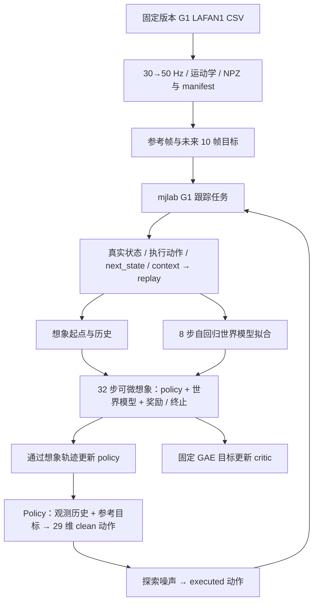

# SuperMimic 学习与复现 · mjlab / Unitree G1

基于 **mjlab** 独立组织的 SuperMimic 研究与学习工程，重点是把参考动作、真实仿真采集、世界模型、策略与价值网络之间的数据流讲清楚。当前已在 Apple Silicon Mac 的 **CPU** 跑通小规模训练闭环，并准备了完整公开 G1 LAFAN1 参考库的下载、转换和加载流程。

**当前状态：可以开始 walk1 / dance1 子集的第一轮训练试跑；尚未验证动作学习效果，尚未复现论文成绩，NVIDIA GPU 训练路径也未验证。** 这是学习中的独立实现，包含明确记录的方法适配，不是论文作者的官方代码。

## 已经具备什么

| 部分 | 当前状态 |
| --- | --- |
| G1 环境与动作接口 | mjlab 原生物理、29 维动作、50 Hz 控制；Mac CPU 已实测 |
| LAFAN1 数据 | 固定来源的全部 40 条 G1 动作，441,140 帧、约 2.45 小时；预处理 v2 已检查 |
| 模型 | policy、可微动力学及解析任务头、学习终止头、critic |
| 训练 | 真实转移 → replay → 8 步世界模型拟合 → 32 步想象 → policy / critic 更新 |
| 记录和恢复 | 配置、版本、源码摘要、真实转移、少量想象轨迹、指标、checkpoint；支持重建环境/replay 后续训 |
| 最新检查 | 72 项单元/组件检查；新数据两轮 CPU 闭环及续一轮；全帧独立插值对照与 120 帧运动学重建 |
| 学习与评测 | 未验证；没有训练/验证/测试划分或正式跟踪成绩 |

本机数据已经准备好，但 **GitHub 仓库不包含数据集、checkpoint、虚拟环境或原始运行日志**。朋友克隆后需执行下方数据准备命令。公开检查摘要见 [验证证据](docs/evidence/README.md)，已知问题见 [known-issues](docs/known-issues.md)。

## 快速开始：先跑最小闭环

已验证环境为 macOS 15.7.7 / Apple M4 / 24 GB / Python 3.12.12，mjlab 固定到 [`8bb2bc9`](https://github.com/mujocolab/mjlab/tree/8bb2bc9e187797689ec82c78c35019afd2fd0376)。Mac 使用 CPU；首次运行包含 Warp JIT 编译。以下命令在仓库根目录执行。

```bash
git clone https://github.com/nowhere2006/SuperMimic.git
cd SuperMimic
python3.12 -m venv .venv
.venv/bin/python -m pip install --cache-dir .cache/pip \
  -c requirements/macos-arm64-py312.txt -e .
.venv/bin/python -m pip check
```

`requirements/macos-arm64-py312.txt` 是此 Mac 环境的版本快照，不是跨平台锁文件。Linux/CUDA 需要单独解析依赖和验证，暂未提供经过验证的 GPU 安装/正式训练方案。

下载并转换公开的 G1 LAFAN1 数据，再检查：

```bash
.venv/bin/python scripts/prepare_lafan1.py
.venv/bin/python scripts/check_lafan1.py
.venv/bin/python scripts/check_resampling.py
.venv/bin/python -m unittest discover -s tests -v
```

数据源为 [`lvhaidong/LAFAN1_Retargeting_Dataset`](https://huggingface.co/datasets/lvhaidong/LAFAN1_Retargeting_Dataset/tree/ce1572906efe6157840e8474d5a0d7aa87481e74/g1)，固定 revision `ce1572906efe6157840e8474d5a0d7aa87481e74`。脚本校验 40 条 CSV 的大小和摘要，从 30 Hz 转为 50 Hz，并输出身体运动学与速度。原始 CSV 约 90.5 MB，参考张量约 754 MiB；模型、Adam 状态、缓存及运行记录还需要额外空间。下载遵循当前进程代理设置；若代理不稳定，可对该命令使用 `--direct` 直连，不修改系统网络。使用数据前请阅读源数据及原始 LAFAN1 的使用条件。

开始一次两轮检查：

```bash
.venv/bin/python scripts/train.py --iterations 2
```

默认 **CPU / 2 环境 / seed 0**，加载全部 40 条，但只从 `walk1_subject1` 和 `dance1_subject1` 采集。使用完整 MLP 宽度、8 步模型窗口和 32 步想象，缩小 batch 与采集规模；两轮通常产生 192 条真实转移。默认时间预算 600 秒，时间检查在训练阶段之间进行，并非严格的外部进程超时。查看输出目录的 `report.json` 和 `run.log`，确认实际状态、完成轮数、检查项与求解器警告。

随后可自行尝试更长的小数据试跑：

```bash
.venv/bin/python scripts/train.py --iterations 100 --max-seconds 600
# 也可显式选子集（不会减少整库加载量）：
.venv/bin/python scripts/train.py --iterations 100 \
  --clips walk1_subject1 dance1_subject1
```

100 轮是试跑请求，不是“学会动作”的保证；时间预算可能使运行提前结束。`--all-clips` 可改变采集范围为全部 40 条，建议在子集检查后再使用。

## 整体数据流



世界模型动力学拟合**实际执行动作**导致的真实转移。动作平滑惩罚与观测中的上一动作使用**加探索噪声前的 policy 输出**。从 `s_t` 执行动作后得到 `s_(t+1)`，奖励对齐 `reference_(t+1)`。更新 policy 时冻结世界模型和 critic 参数，保留它们对输入的梯度；critic 用一次生成并固定的 GAE 目标训练。详细形状、单位、坐标与梯度路径见 [架构](docs/architecture.md) 和 [训练闭环](docs/training-loop.md)。

## 与论文及参考实现的关系

目标机制是 SuperMimic 的在线采集、世界模型拟合，以及通过可微想象更新策略和价值网络。实现过程中参考论文、mjlab 源码和第三方复现，并明确记录没有公开唯一答案的工程选择。

- 默认世界模型为六组物理误差的 **L1 + 首次误差尺度校准**，受 SuperTrack 启发，是对论文状态 MSE 的显式适配。可用 `--world-model-loss raw_mse` 新开对照，不能把默认损失称为逐项照搬论文。见 [误差与尺度](docs/world-model-errors.md)。
- critic 附加相对根位置/yaw 共 4 维；policy 使用 93×10 历史与 68×10 参考目标。编码、积分和终止头含有已记录的工程选择。见 [critic 输入](docs/critic-input.md)。
- CPU 的环境数、batch、episode 长度和采集/更新比例用于检查，不是论文正式实验配置；没有据此声明性能。
- clean/executed 动作语义和预处理 v2 已修复并核查；旧动作语义或不匹配数据 manifest 的 checkpoint 拒绝自动续训。见 [集中语义审查](docs/semantic-audit.md)。

## 运行记录与续训

每次运行创建 `output/training-runs/<UTC timestamp>/`，保存配置、源码副本/摘要、版本、seed、数据 manifest、指标、事件、转移、少量想象 probe 和 checkpoint。默认每 10 轮保存周期 checkpoint / probe，保留最近 3 个周期快照，另存 initial / final / 必要的 emergency。完整 checkpoint 约 200 MiB，写盘有额外成本。

```bash
.venv/bin/python scripts/train.py \
  --resume output/training-runs/<run>/checkpoints/<complete-checkpoint>.pt \
  --iterations 100
```

`--iterations` 表示本次额外轮数。只接受完整迭代快照，并检查方法和数据版本；恢复模型、Adam、采样器及调度后重建环境/replay，属于继续训练，不能逐步恢复原仿真现场。Ctrl-C 尽力保存诊断快照；partial/emergency 不冒充完整快照。详细存档和限制见 [训练记录](docs/training-records.md)。

## 文档阅读顺序

1. [整体架构与数据流](docs/architecture.md)：先理解各模块职责。
2. [G1 接口](docs/g1-interface.md) → [LAFAN1 加载](docs/lafan1-loading.md) → [模型初始化](docs/initialization-contract.md)。
3. [训练闭环](docs/training-loop.md) → [误差尺度](docs/world-model-errors.md) → [critic](docs/critic-input.md)。
4. [开发日志](docs/project-history.md) → [已知问题与待验证事项](docs/known-issues.md) → [集中核对](docs/semantic-audit.md)。
5. [公开验证摘要](docs/evidence/README.md)、[训练记录](docs/training-records.md)、[预备评测](docs/evaluation-backlog.md)。

历史文档保留“当时尚未实现”的阶段描述；以本文与最新日期的核对记录判断当前状态。`output/` 路径是本地历史产物位置，克隆不会附带这些文件。公开摘要不替代全部原始运行证据，也不构成独立第三方复跑。

## 致谢与来源

感谢 **[CuboiLeo / SuperMimic-Reproduced](https://github.com/CuboiLeo/SuperMimic-Reproduced)** 的公开工作，为我们理解 SuperMimic 的状态表示、目标编码、动力学和训练工程提供了重要参考。比较基准固定在 [`d9be385`](https://github.com/CuboiLeo/SuperMimic-Reproduced/tree/d9be385b3eeb13a638fb33fb200d3bfd9be9839f)，并保留其 MIT 声明（Copyright © 2026 Yuxi Liu）。本项目独立组织模块，对差异逐项核对；参考仓库的成绩没有作为本项目实测结果。

感谢 [mjlab](https://github.com/mujocolab/mjlab) 提供 G1 模型、执行器、仿真、管理器和随机化能力，感谢 [BeyondMimic / whole_body_tracking](https://github.com/HybridRobotics/whole_body_tracking) 及其被 mjlab 采用的跟踪任务设计，感谢 [SuperTrack](https://theorangeduck.com/media/uploads/other_stuff/SuperTrack.pdf) 的可微控制与损失设计思路，也感谢公开 LAFAN1 G1 重定向数据的贡献者。

论文依据为用户提供的 *SuperMimic: Scaling Humanoid Whole-Body Control with One Differentiable World Model* PDF（标记 arXiv:2610.28480v1，2026-10-20）；版本摘要见 [资料记录](docs/mac-feasibility.md#论文依据与学习边界)，PDF 不随仓库分发。

第三方来源、固定提交和许可证见 [third_party/README.md](third_party/README.md)。第三方代码保留各自许可，数据/机器人资产遵循上游条件。当前尚未为本项目自有新增代码选定独立许可证；public 可见性本身不授予额外许可。
