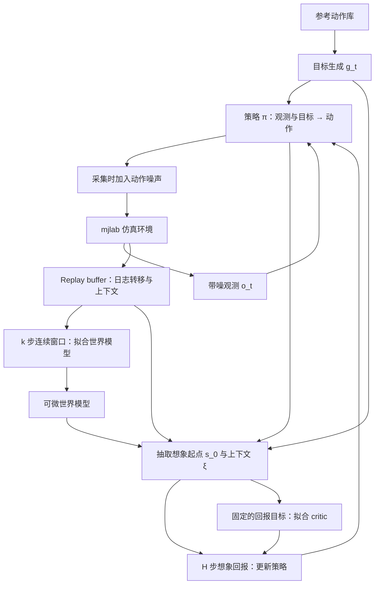

# SuperMimic 架构与数据流

这是本项目的架构与实现状态。当前已在本机CPU通过小规模三阶段训练闭环；图中的数据流均有对应模块，但不代表学习效果或论文规模已验证。详细接口、时间约定与证据见 [训练闭环](training-loop.md)。

## 整体数据流

数据流分成两种时序：仿真采集记录实际发生的转移；想象 rollout 在模型内预测未来并保留梯度图。想象轨迹不冒充真实仿真样本写回世界模型的监督数据。

## 模块职责与开发状态

| 模块 | 输入 → 输出 | 谁使用 | 当前状态 |
| --- | --- | --- | --- |
| 运行底座 | 设备、依赖、场景定义 → 可步进和重置的仿真状态 | 后续环境封装 | 最小 CPU 场景检查通过 |
| 动作数据与目标生成 | 重定向后的 G1 参考动作、动作索引和时间 → 目标 g_t 及奖励所需参考量 | 策略、环境、想象 rollout | 完整40条加载；参考时钟及回报bin采样已实现，正式实验数据划分待定 |
| 仿真任务与采集 | 策略动作、随机化配置 → 日志转移及观测 | buffer、运行诊断 | 参考状态重置、共享奖励/硬终止、实际DR和动作噪声已接通 |
| Replay buffer | 连续转移 → 模型拟合窗口、想象起点及匹配的上下文 | 世界模型训练、策略训练 | 按环境ring及episode/状态/时间连续性检查通过 |
| 世界模型及各输出头 | 状态 s_t、动作 a_t、上下文 ξ，必要时加目标 → 下一状态、奖励、无噪观测、终止概率 | 模型拟合、想象 rollout | 动力学与学习终止头实际更新；解析FK/奖励/观测已核对 |
| 策略与 critic | 策略读观测和目标；critic 读状态、目标、上下文及相对目标根位姿4维 → 动作、价值估计 | 采集、想象、更新 | 两轮CPU检查及续训通过；学习质量未评估 |
| 想象与更新 | 起点、目标序列、模型、策略、critic → 想象轨迹、损失、梯度更新 | 训练调度 | H32 BPTT、软生存、bootstrap、固定GAE及冻结权重检查通过 |
| 调度与仿真评估 | 模块、配置、训练预算 → 交替更新、检查点、评估记录 | 用户分析结果 | smoke调度与检查点已实现；正式GPU评估和精确续跑未实现 |

当前张量布局与头的工程补充项见训练闭环说明；它们不能自动视为论文已公布的作者实现。

## 两种窗口与三组参数

- 世界模型拟合窗口 **k**：从 buffer 取连续日志，使用记录的执行动作展开，比较预测与真实日志。论文默认 k=8。
- 策略想象长度 **H**：从 buffer 的状态起步，让策略与世界模型交替展开。论文默认 H=32，critic 估计窗口之外的回报。
- 世界模型参数 **ω** 在监督拟合阶段更新；策略参数 **θ** 在想象回报的 BPTT 阶段更新；critic 参数 **ψ** 对固定的回报目标拟合。

策略更新时，冻结世界模型的权重不代表切断模型计算图。动作仍要影响预测状态、奖励与之后的动作，梯度才能回到策略。仿真器本身不需要可微。

日志需要区分状态 s_t、无噪观测、带噪观测 o_t 和目标 g_t；世界模型使用的仿真随机化上下文 ξ，不自动成为部署策略可见的信息。采集时加的动作噪声要反映在记录的执行动作里；观测噪声在模型外产生。

连续窗口还需要保留 episode 和时间对应关系，不能把重置后的新状态当成上一 episode 的正常动力学后继。任务终止与时间上限截断分别记录；具体采样和掩码规则在 buffer 模块实现时核对。

## 两个阶段

1. **Mac 最小闭环**：最终要验证少量环境与动作下，真实仿真采集、buffer 窗口、世界模型拟合、想象及策略/critic 更新能接通，数据对应关系和梯度更新正确。不要求学会动作。
2. **GPU LAFAN1 训练**：沿用核心模块，调整设备与规模，先确定正式评价协议和资源预算，再验证学习效果。Mac 检查不验证 CUDA 路径或论文性能。

历史底座、[G1接口](g1-interface.md)、[动作库](lafan1-loading.md)、[初始化](initialization-contract.md)检查仍保留。新增[训练闭环](training-loop.md)已验证短时真实采集和SuperMimic更新/梯度路径；长时接触稳定性、动力学准确度、CUDA路径、动作学习效果及论文结果仍未验证。

## 本文依据

用户提供论文的第 4–5 页（Figure 2、§3.1–3.3、式 1–3），以及附录 D 的训练循环。本文是本项目的模块组织提议，不是作者代码目录的复刻。

底座行为按 [mjlab 固定提交](https://github.com/mujocolab/mjlab/tree/8bb2bc9e187797689ec82c78c35019afd2fd0376) 核对；第三方实现参考快照与偏离项见 [本地可行性记录](mac-feasibility.md)。
