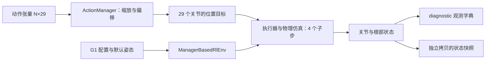

# G1 基础接口

本模块将 mjlab 自带的 G1 接入我们自己的诊断环境。它验证机器人、动作、状态和重置接口，没有参考动作、策略网络、奖励学习或世界模型。

## 当前数据流



一个环境控制步为 0.02 秒，内部含 4 个 0.005 秒物理步。位置目标在这 4 个物理步内交给执行器；目标值不等于该步结束时的实际关节位置。

## 对外函数

实现：`src/supermimic_study/envs/g1.py`。

| 函数 | 输入 | 输出及职责 |
| --- | --- | --- |
| `make_g1_diagnostic_cfg` | 实例数量、随机种子 | 诊断环境配置，包含 G1、地面、位置动作、无噪声状态观测和超时检查 |
| `describe_joint_interface` | 已建立的环境 | 每个动作列对应的关节名称、关节状态列、缩放系数和默认角度 |
| `read_g1_state` | 已 reset/step 的环境 | 当前状态的独立张量拷贝，之后仿真或重置不会修改这份快照 |

环境建立和调用继续使用 mjlab 原生接口：

```python
from mjlab.envs import ManagerBasedRlEnv
from supermimic_study.envs.g1 import make_g1_diagnostic_cfg, read_g1_state

env = ManagerBasedRlEnv(cfg=make_g1_diagnostic_cfg(num_envs=2), device="cpu")
try:
    obs, extras = env.reset()
    state = read_g1_state(env)
    # action 由调用方提供，形状为 [2, 29]
    # next_obs, reward, terminated, truncated, extras = env.step(action)
finally:
    env.close()
```

完整可执行入口为 `scripts/check_g1.py`，它在导入 mjlab 前配置项目缓存路径。

## 状态接口

N 是并行环境数量，本次检查 N=2。以下字段既作为 `obs["diagnostic"]` 的独立条目，也可通过 `read_g1_state` 取得快照。

| 字段 | 形状 | 含义与单位 |
| --- | --- | --- |
| `joint_pos` | `[N,29]` | 关节实际角度，rad |
| `joint_vel` | `[N,29]` | 关节实际角速度，rad/s |
| `root_pos_w` | `[N,3]` | 根部位置，世界坐标，m |
| `root_quat_w` | `[N,4]` | 根部姿态，世界坐标，四元数顺序 w,x,y,z |
| `root_lin_vel_w` | `[N,3]` | 根部原点的世界线速度，m/s |
| `root_ang_vel_w` | `[N,3]` | 根部的世界角速度，rad/s |

这些字段是诊断接口，不预先规定论文的完整模型状态或策略观测布局。后续接入世界模型时还要核对模型所需的量。

两个环境分别位于不同的场景原点，本次初始根部位置约为 `[1,0,0.76]` 和 `[-1,0,0.76]`。这些水平偏移来自并行场景布局；匹配参考动作时需要明确世界坐标与环境原点的关系。

## 动作接口

动作张量的形状是 `[N,29]`。具体列顺序从运行中的 action term 取得，并与 `robot.joint_names` 核对，不假设数据文件与仿真器采用相同顺序。

当前诊断配置没有裁剪或编码器偏差随机化，使用 mjlab 的默认姿态偏移和 G1 动作缩放：

```text
关节位置目标 = 默认角度 + 动作 × 对应关节缩放系数
```

mjlab 的实际动作实现还会扣除编码器偏差；本诊断环境中该偏差为零。全零动作请求默认姿态，并不表示执行器不施力。

本次左肘样例（动作与关节索引均从 0 开始）：

- 动作列：18，对应 `left_elbow_joint`，关节状态列也是 18。
- 默认角度：约 0.6 rad。
- 缩放系数：约 0.438577 rad / 动作单位。
- 原始动作：0.2。
- 位置目标：约 `0.6 + 0.2×0.438577 = 0.687715 rad`。
- 该控制步结束时读到的左肘实际角度约 0.618612 rad，已单独记录在报告中，不能把目标值当成测量值。

这是输入转换检查；它不证明机器人能稳定站立或完成动作跟踪。

## 结束与重置

诊断环境配置为 `auto_reset=False`：结束时保留终止物理状态，调用方完成读取后再显式重置。若还有结束的实例未重置，下一次 `step` 会拒绝执行。

这是为后续采集接口验证边界，并不代表当前已经实现 replay buffer。检查中仅有时间上限，没有论文的动作跟踪失败判据；奖励字典为空，不用于训练。

本次通过的检查包括：

1. 29 维动作映射无重复、与关节名称一致，初始状态和观测对应。
2. 零动作目标与默认角度一致，左肘非零动作按预期缩放。
3. 两实例运行 8 个控制步，状态有限、关节动力学推进，旧快照没有被后续仿真覆盖。
4. 只重置实例 0 后，其状态恢复，实例 1 的已读状态保持不变。
5. 仅把实例 0 的 episode 计数器推到时间上限前一格，验证下一步返回截断标记并保留结束状态，且要求重置后再继续。计数器注入是诊断步骤，不是训练数据或任务失败定义。
6. 全量重置恢复初始状态。

运行命令：

```bash
.venv/bin/python scripts/check_g1.py --device cpu --num-envs 2 --steps 8
```

实际版本、完整关节/身体列表与映射、配置和结果见 `output/g1-interface.json`；编译和运行日志见 `output/g1-interface.log`。当前只实测 CPU，尚未验证 CUDA 路径、长时稳定性或与论文任务一致性。

## 来源

机器人资产、执行器、动作缩放和环境生命周期均使用已安装的 [mjlab 固定提交](https://github.com/mujocolab/mjlab/tree/8bb2bc9e187797689ec82c78c35019afd2fd0376)。本模块调用其公开接口，自行组织诊断配置与检查，没有复制第三方 SuperMimic 的训练代码。
