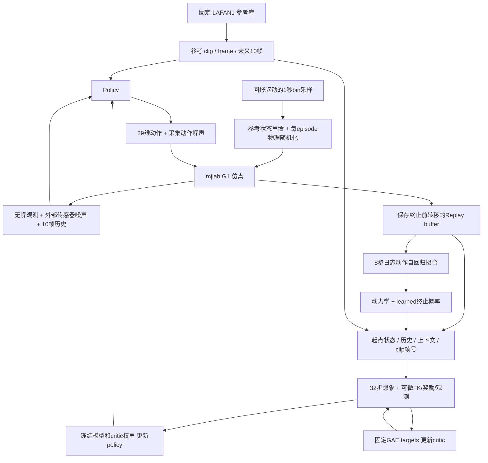

# SuperMimic 最小训练闭环

2026-10-26 在本机 CPU 实测通过。这里的“跑通”指真实采集、世界模型拟合、想象、policy/critic 更新均执行且数据/梯度检查通过，不表示策略已经学会动作或达到论文成绩。

后续已补充逐轮/转移/probe落盘、周期checkpoint、Ctrl-C保存和重建环境后的续训入口，见 [训练记录](training-records.md)。本文下方 `cpu-loop-seed0-final` 是最初闭环样例，旧format-v1快照不支持新增续训入口。评测分析方案目前仅在 [待办](evaluation-backlog.md) 中，没有周期评测加入训练。

## 先看完整数据流



数据集是**参考动作**，不是机器人当前 policy 的经验。世界模型的训练样本来自 mjlab 在线执行的真实转移。想象轨迹不写回真实经验库。

## 每个模块负责什么

| 文件 | 职责 | 主要输入 → 输出 |
| --- | --- | --- |
| `envs/tracking_task.py` | mjlab 外层任务适配器；参考状态重置、DR上下文、任务信号、采集历史 | 执行动作 `[N,29]` → 不含重置污染的 transition |
| `training/sampler.py` | 1秒 bins，50%均匀/40%低回报softmax/10%历史权重 | 完成的 episode 回报 → 下次 clip/frame 起点 |
| `training/replay.py` | 按环境 ring；检查 episode、clip、frame、context 和 state连续性 | detached transitions → `[B,8,...]` 窗口或想象起点 |
| `models/kinematics.py` | 从固定 MuJoCo 模型常量建立纯 Torch FK | state71 → 全部30个身体位姿与速度 |
| `models/heads.py` | 共享解析观测、奖励与仿真硬终止 | state/reference/action/context → 观测93、奖励、失败标签 |
| `models/world_model.py` | 动力学核心 + 解析头 + 学习终止头 | state71/action29/context33 → nextstate71；参考辅助输出reward/终止概率 |
| `training/history.py` | 真实与想象共用历史布局与外部传感器噪声 | 当前93维帧 + 930维历史 → 下一930维历史 |
| `training/returns.py` | 论文式2生存加权回报、式3固定GAE目标 | 想象 rewards/dones/values → actor objective / critic targets |
| `training/loop.py` | collect → fit WM → imagine/update actor → fit critic | 核心模块与配置 → 各阶段更新、梯度与冻结证据 |

默认仍使用论文 Table A.4 的完整隐藏层宽度。policy 8,891,197 参数；world model 含终止头 8,863,047 参数；2026-10-27补充4维相对目标输入后critic为235,009参数（此前233,985）。详见 [critic输入与时间](critic-input.md)。

## 一步真实采集的时间对应

1. 在 `s_t`，policy 读取带噪历史 `o_{t-9:t}` 与当前起算的10帧参考 `g_t`；目标窗口沿用初始化约定 `frame_t ... frame_t+9`。
2. 明确 `a_t = policy(...)` 和实际执行 `u_t = a_t + epsilon_t`，其中epsilon每维高斯标准差.1。buffer同时保存a/u及各自的previous版本；动力学监督只读u，平滑惩罚只比较a。
3. mjlab 完成控制步 `.02s`，调用 forward 刷新真实状态。参考时钟推进到 `frame_t+1`。
4. 用 `s_{t+1}` 和同一时刻参考计算 `r_{t+1}`、失败标签；奖励平滑项比较a_t与a_(t-1)，新观测中的previous action为加噪前a_t。
5. 把 `s_t, policy_action=a_t, executed_action=u_t, previous_policy_action, previous_executed_action, s_{t+1}, r_{t+1}, terminated, truncated, context, clip/frame, history_t` 复制入库，然后才重置done环境。兼容别名action=u_t、previous_action=a_(t-1)入库时强制核对。

**时间约定是显式的工程选择**：奖励使用 post-step 状态和下一参考帧；想象 rollout 完全一致。它避开 mjlab 自带 manager reward 在 forward/参考推进前计算时的一子步陈旧状态。论文没有提供作者代码来确认其具体实现偏移，因此不能宣称与作者逐指令等价。世界模型拟合窗口的第 j 条动作必须通向记录的 next_state，所有 window 都检查连续性。

## 哪些参数何时更新

2026-10-27 用户选择参考 SuperTrack 调整世界模型损失。当前默认采用六组几何误差的 L1，并按首次真实窗口的初始误差固定分母，使各项初期贡献接近；见 [世界模型预测误差](world-model-errors.md)。历史下方运行证据来自旧raw MSE，不能当作新损失验证。

- **世界模型拟合**：从真实 buffer 的一个状态起步，在8步内始终使用日志动作自回归预测，不用真实中间状态替换预测。默认将预测与真实状态的根位置/相对旋转向量/根线速度/根角速度/关节角/关节速度分成六组，每组绝对误差按分量和batch平均、除以首次窗口校准的固定尺度，再将六组及8步求和；加上hard failure BCE的batch均值/时间求和（独立系数默认1）。相对旋转忽略四元数反号。保留 `raw_mse` 模式作为旧基线。解析奖励/观测没有可训练权重，不加对应loss；其一致性另外检查。只更新动力学和终止网络，校准分母不带梯度且保存于checkpoint。
- **策略想象**：从buffer取状态、实际输入历史、previous_policy_action、物理上下文和参考帧。模型权重和critic权重关闭梯度，输入仍留在计算图中。展开32步，观测噪声在模型外重新采样；想象动作不加探索噪声，因此本步clean/执行指令相同，但起点previous必须使用日志clean动作。回报中当前奖励乘 `c_t`，随后更新 `c_{t+1}=c_t*(1-dhat_{t+1})`；末端还有critic bootstrap。只更新motion encoder和decoder。
- **critic**：在 actor 更新前由同批想象轨迹计算一次 GAE targets，并 detach。随后对 detached state/goal/context/根部相对误差4维 拟合5 epochs、每轮4个随机 minibatches。每步V与同一时刻参考对应，末端root-error保持可微以供actorbootstrap使用。target保持固定，只更新critic。

上下文33维为每个 episode 的实际足部共享摩擦1维、encoder bias29维、torso COM偏移3维。DR通过 mjlab 接口作用于真实物理模型，范围按 Table A.3；每次重置重新采样，不加入速度推扰。它供世界模型/critic 使用，不直接输入部署 policy。

## 与论文及第三方的边界

- 论文明确：三阶段在线交替、k8/H32、观测93及10帧历史、32维tanh latent、网络隐藏层、奖励权重/标准差、失败阈值、噪声和DR范围。
- 现有工程约定：state71、goal每帧68、残差70维积分、SiLU及量纲缩放沿用先前记录。完整轨迹实际计算时还携带 previous action、历史与参考时间；不能把 state71 称作论文已明确给出的完整 Markov state。
- body reward 跟踪14体，torso anchor及水平位置/yaw对齐沿用固定 mjlab G1 BeyondMimic 实例。全局速度项不做该对齐。论文没有列出具体 T/anchor；失败终止则明确用 pelvis，阈值为高度差>.25m或重力z分量差>.8，无末端偏差终止。
- 学习终止头采用 `(256,128)` MLP，输入 canonical state71 与参考pelvis高度/局部重力4维，末层bias=-2；这些头细节由工程补充，不是论文公布参数。
- return sampler 用 EMA(.1) 估计访问 bin 的折扣后缀回报，以累计过去的softmax分布保存历史权重；Gmax用理论每步最大奖励`.1/(1-.99)`。论文未指定这些估计器细节。
- 学习终止头只拟合失败 `terminated`，不把时间上限/clip尾 `truncated` 当作失败。想象起点排除不能容纳完整32步的clip尾，不跨动作展开。重置后的10帧历史用新首帧回填。
- 每阶段 Adam lr2e-4；policy betas(.9,.95)；全局梯度norm裁剪1，policy再逐元素裁剪.1；gamma .99、lambda .95。学习率实现250k迭代cosine到.03倍、随后不变。CPU smoke仅两轮，不能据此验证完整schedule或训练收敛。

## CPU 运行与实际证据

```bash
.venv/bin/python -m unittest discover -s tests -v
.venv/bin/python scripts/train_smoke.py
```

入口默认创建独立时间目录，不覆盖既有结果；可指定尚不存在的 `--output`。`--device` 和规模配置与核心算法分离；本轮仅验证CPU，不验证CUDA。默认 profile 在 `training/config.py`，不是正式GPU训练协议。

| 配置 | 本轮 CPU smoke | 论文 Table A.5 |
| --- | --- | --- |
| 真实并行环境 | 2 | 4096 / GPU |
| 加载/采集动作 | 加载完整40条，采集walk1/dance1 | LAFAN具体clip身份尚无作者清单可核实 |
| replay 容量 | 256 steps/env | 1000 steps/env |
| WM update | 2 batches × 8 windows | 10 batches × 2048 windows |
| WM window / imagination horizon | 8 / 32 | 8 / 32 |
| 想象 batch | 2 | 4096 |
| 采集与更新 | 预热64步，每轮16步，2轮更新 | UTD .4，320k迭代 |
| 仿真数值配置 | .005s×4，solver10/line-search50 | 当前固定mjlab模板原为10/20；论文未列该数值配置 |

最终报告：`output/training-smoke/cpu-loop-seed0-final/report.json`；运行日志同目录 `run.log`，单元测试日志 `tests.log`，权重/优化器等在 `checkpoint.pt`。

- 真实采集192条转移、完成5次失败重置；两轮均执行WM、policy、critic更新。
- FK与真实身体状态位姿/速度最大差约 `9.54e-7`；实际含encoder bias的93维观测核对通过。
- 18条真实转移的解析奖励重算与仿真任务奖励最大差约 `1.49e-8`。这证明当前共享定义的一致性，不是作者奖励实现等价证明。
- 两轮actor梯度norm约 `.001379 / .001438`；motion encoder与decoder均有梯度。动作到预测状态、末端critic对输入状态的梯度均有限且非零。
- actor阶段世界模型和critic权重未变；critic阶段policy/WM未变；GAE targets固定；保存后安全加载逐张量核对通过。
- 有限输出/非零梯度不证明梯度方向适合长期控制，不证明模型预测精度、reward改善或动作学习效果。当前encoder梯度很小，但未据此调整算法。

检查点保存模型、优化器、sampler统计、配置、torch RNG、代码与数据摘要；没有保存完整仿真器、buffer和在途episode，**不是精确续跑检查点**。代码仓库尚无HEAD，报告明确为null并保留源文件SHA256，不伪造commit。

失败和偏离保留：首次集成因FK误包含terrain而在训练前失败，报告位于 `output/training-smoke/20261026T082559.946877Z/`；已修复为只取G1子树并补测试。初次通过运行 `20261026T082850.964787Z/` 有3次line-search20上限提示；将训练profile上限设为50后，最终运行未出现该提示。没有屏蔽求解器警告。

下一阶段仍需正式训练/评估协议、GPU配置验证、长时稳定性与模型误差评估；本轮没有租卡、远程传输、提交或推送。
